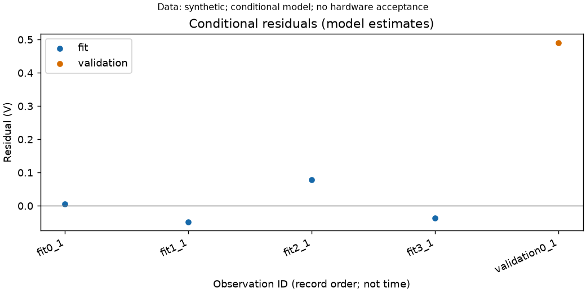

# 静态线性辨识与名义留出验证（S6-T03 部分）

2026-11-13。本轮全部来自合成文件，没有实机测量，也没有参数升级。

```bash
python -m pip install -e ".[ident]"
zlscan ident --table measurements.csv --metadata metadata.json \
  --static-fit static.json --out identified_static
```

Matplotlib 为新增 ident 可选依赖，用于标准 SVG/PNG 残差图；不影响不带
--static-fit 的导入。示例配置 `docs/examples/static_fit.json` 中置信水平、
数值尺度、秩阈值与模型形式都是公开的示例协议选择，不是设备参数；
必须把测量 ID 和假设来源换成实际记录，并明确选择合适的数值尺度。
留出容差默认 null，即未评估，不代填产品要求。

候选模型 y=截距+Σβj xj。配置 features 逐项声明名字和 SI 数值尺度，
intercept 显式选择是否截距；observations 逐条通过表中 measurement_id
配对输入/输出，不靠行顺序或 reference_id 猜测配对/同步。特征/输出
各自必须保持数量类型和 SI 单位一致，模型不自动转换对数、密度或透射率。
输出不能重复使用，也不能同时作为输入。各对记录必须同属 fit 或 validation。
实际来源摘要与采集身份需完整；来源不可信或声明中复用拟合/验证来源时拒绝。
无参照原文件的表仍可导入查看，但不能走这个辨识流程。

本阶段仅实现显式条件加权线性回归：输入为声明值，输出误差按用户明确
声明的独立高斯、给定标准不确定度处理。output_error_model 与
input_handling 必须明确认可对应假设，assumption_source 记录依据。
输出标准不确定度必须已声明、正且来源非空；不将扩展不确定度或绝对
界限自动换成 sigma。输入不确定度逐项保留并标注不参与传播，不当作零，
因此结果只是给定输入声明值条件下的经验模型，不是完整物理误差模型。
有输入误差、共享参考偏差或相关噪声时，条件系数不能直接当作真实器件增益。
未知硬件条件继续在外层表报告中列出，不由回归补全。

仅 fit 构造 D 和已知 sigma 加权的 A=D/sigma，数值秩按显式 rank_rtol
相对最大奇异值确定。右奇异向量给出可辨识组合与零空间；不正则化补秩，
无参数先验。系数坐标 gamma=β×scale，截距 scale=1；输出说明组合坐标及
最小范数诊断代表，不把代表解当唯一的物理系数。非唯一单参数及相应
协方差/相关性项为 null；有唯一支持的单参数保留。

在声明的高斯/已知 sigma 假设下由 SVD 构造条件协方差，不用拟合残差
缩放 sigma。即便合成数据恰好在线上，参数区间也不会自动变成零宽度。
区间是给定置信水平的边际条件区间，不是同时置信区间，不包含输入、
系统误差、模型失配或未知仪器响应。报告给出参数相关性、组合、零空间、
拟合逐点残差、自由度及条件卡方统计；零自由度不生成拟合卡方 p 值。
数值秩、条件数和参数尺度应一起看，不能把数值阈值当硬件可辨识性证明。

validation 不决定系数、尺度、秩或协方差。验证设计若含零空间方向，
预测/残差为空并标为 prediction_not_identifiable，不用最小范数代表
生成看似确定的预测。验证在拟合特征范围外会明确标记，不借此自动
修改模型或改取样范围。名义残差为观测减预测，均值条件区间不包含新观测噪声。
只有显式 validation_max_abs_residual_si 时才比较最大逐点绝对残差；
没有验证记录为 not_executed，没有容差为 not_assessed，不自动算通过。
compatible 也仅表示声明容差下的名义留出误差相容；数据统计独立性仍未证明。

run.json 保存配置/原始表/元数据摘要、参数及诊断；static_residuals.svg/png
使用标准 Matplotlib 导出，分开显示拟合/留出记录，不跨记录插值。CLI 对
拒绝、部分/完全不可辨识或名义验证失配返回非零，同时保留诊断与图；
缺 Matplotlib ident 依赖时明确报错，不把缺图算成功。原表/来源不改，
不覆盖旧目录。始终 MODEL_ESTIMATE、hard_acceptance_eligible=false、
independence_established=false、parameter_upgrades=[]。不生成生产标定头。

## 合成文件案例

`tools/audit_static_identification.py --out ...` 生成可追溯的原始标量 JSON、
测量表、侧车、配对配置，再通过新进程公共 CLI 执行三例；`--verify ...`
在另一个进程重新读文件、辨识并比较全部辨识结果及输入摘要。

| 案例 | 拟合结果 | 留出结果 | CLI |
|---|---|---|---|
| 完整秩相容 | 截距 1.034 V、斜率 1.984 V/V | 名义残差约 0，0.1 V 声明容差内 | 0 |
| 完整秩失配 | 与上例完全相同；只改留出输出 | 留出残差 0.49 V，超过声明容差 | 1 |
| 共线特征 | 截距可辨识，两个单独增益为空 | 留出设计不在可辨识子空间，预测为空 | 1 |



这些数值与 sigma=0.1 V、置信水平 95% 均为合成协议，不是机器精度。
开发运行与新进程重读已一致，原输入摘要未变；图已渲染检查。正式干净提交
记录另行附后。动态、时基、几何、辐射非线性与真实共享误差模型仍未实现于
该入口；真实来源、可辨识性与独立实测验证门槛仍未完成，阶段6不关闭。

最终代码全量测试 1240 通过、2 跳过（159.89 s，Icarus 不可用）；Ruff/格式通过。辨识/观测/导入/CLI 定向 76 项通过（3.87 s）。首轮全量 1240/2（176.19 s）后仅补来源标签并再次全量通过；测试耗时不是扫描性能。

干净实现提交 `3dbb7a8` 的正式复跑：定向 76 项通过（pytest 报告 8.86 s）；
三例公共 CLI 运行 17.64 s，新进程文件重分析 2.52 s。全部辨识结果重读一致，
来源摘要不变，归档合成残差 PNG 与正式输出逐字节一致。汇总见
`docs/reports/static_identification_audit.json`，正式记录位于
`evidence_runs/2026-11-13_static_identification/record/`。两个负例 CLI 退出 1
是预期拒绝行为，审计脚本退出 0 只代表诊断正确，不能读作验证失配已消除。
这些执行时间不代表采集/重建性能。
