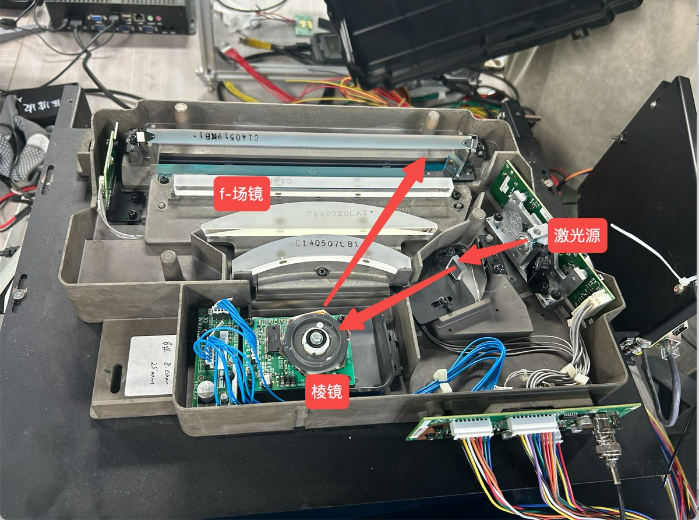
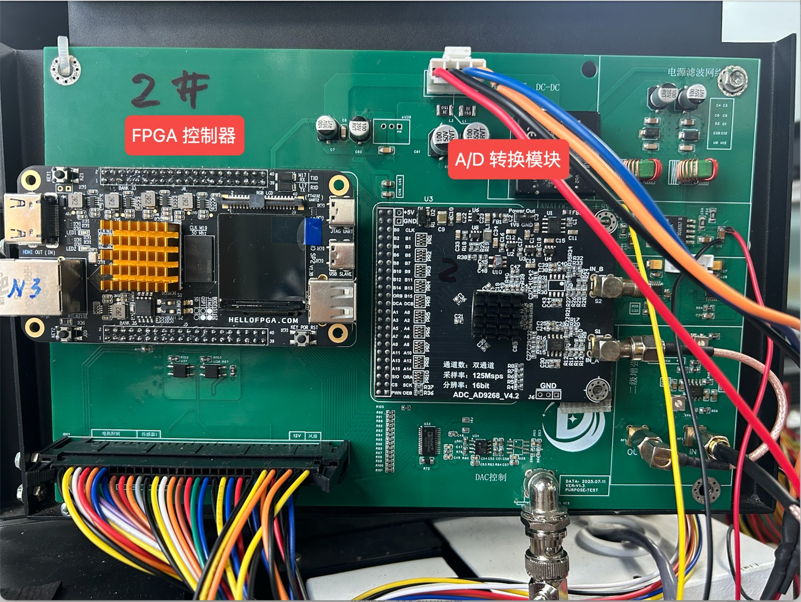

# 底片扫描仪：从第一束激光到完整数字图像

**ZL_OEM_SCANER / 仿真设计与实施指南**  
2026-11-10 · 基于用户调研记录、开发板照片与SmartZynq SP2原理图

> 核心方案：先建立能逐采样追踪的光电—模拟—数字行为模型，再用实测参数、SPICE和RTL分别替换关键子模型。不要一开始就把整机机械、光学、半导体和FPGA全部塞进同一个仿真软件。
>
> 本包已经提供可运行的Python端到端模型及结果；其物理参数主要是演示假设，不是对实物精度的认证。原始证据[P1–P4]和官方参考[E1–E14]见《官方资料索引》。

## 1. 现有资料究竟能确认什么

调研照片第1页标注了“激光源”“棱镜”“f-场镜”。扫描组件外观支持多面转镜的判断，但照片不足以确认反射面数、转速、镜头真实处方与所有折叠反射面的顺序。这里采用“多面转镜或其他周期扫描镜＋平场扫描光学”的功能模型；不能把照片上的棱镜自动当作透射色散棱镜。[P1，第1页；E3]

第2页明确标出了PMT、PMT高压模块、对数放大器，并有示波器上“有效范围”和“激光穿过底片部分”的标注。这支持透射式、时间扫描、单点光电接收的系统解释，但不能从照片直接读出PMT增益、信号正负极性、带宽或绝对光功率。[P1，第2页]

第3页放大后可读到采集模块丝印 **ADC_AD9268_V4.2、双通道、125Msps、16bit**。这是较强的板级型号证据，但散热片遮住了主芯片，仍应核对实物料号、模块原理图和SPI读回。板上标称125MSPS不证明整机正在以125MSPS运行，也不证明两路都用于底片信号。[P1，第3页]

你的开发板正面可读SP2 V1.3B。原理图列出XC7Z020、标称512MB的16bit DDR3、PL侧50MHz晶振和RTL8211E千兆PHY。J5为Bank35、3.3V；J6为Bank33、VADJ，默认3.3V。J5在V1.3/V1.3B与旧版的排针排列不兼容。VADJ应核对供电电阻配置，不能只改XDC，也不能假定软件或跳帽就能改变电压。[P2，第1、3、7–12页；P3]

**必须保持未知的项目**：激光实际波长/功率、镜面数/转速、镜头焦距与光斑、片后收光结构、PMT型号/高压/电流限制、对数和后级电路、AD9268第三方模块的输入耦合与电平转换、SOS来源及送片编码器。这些都已列入实测参数CSV。

## 2. 先看完整信号链

功能链可以写为：

**激光驱动与光源 → 准直/整形/可能的折叠反射 → 扫描镜 → f-θ或其他平场扫描光学 → 底片上的移动光点 → 透过底片的光 → 收光腔/光导/反射或聚光结构 → PMT光阴极 → 倍增极与阳极 → 对数或线性模拟前端 → 抗混叠与差分驱动 → 外部ADC → FPGA接收与坐标标签 → FIFO/DDR → 上位机重建与保存。**

其中准直、折叠光路和收光形式是功能占位，并非已经从照片确定每一个零件的位置。需要实物追光、尺寸和镜头资料后才能画出可信的机械光路。[P1；E3]

PMT高压模块不在光传播路径中。它建立PMT内部电场和倍增条件；电源、转镜驱动、送片电机、SOS与编码器都是旁路控制系统。PMT之后已经不再是光，而是电荷、电流、电压和数字码。[E1–E2]

PMT本身不输出二维图像。每个时刻只有一个或几个电信号；二维坐标来自“当前是第几行、该行扫描到哪里”。因此整机必须同时保存**测量值、位置、时刻和有效性**。只把ADC波形存下来而没有同步关系，通常不能可靠地恢复几何正确的底片。

## 3. 从激光发出到照在底片上

实际光源可能连续发光，再由光点移动形成逐像素扫描，不必假设“每个像素发一束脉冲”。模拟模型可把发射功率表示为：

`P_L(t) = P0 × laser_enable(t) × [1 + slow_drift(t) + ripple(t)]`

`P_film(t) = P_L(t) × η_pre(t, x)`

准直和扩束决定进入扫描光学的光束直径与发散；扫描镜改变传播方向；平场光学把不同角度变成底片平面的不同位置。理想f-θ关系为 `x = f × θ_opt`，普通薄透镜的简单几何关系则为 `x = f × tan(θ_opt)`。两者不能混用。镜面法线旋转小角度φ时，反射光方向变化约为2φ；这个2倍关系适用于反射扫描镜，不应无条件套在任意棱镜机构上。[E3]

若确认是N面转镜、每面产生一条有效扫描线，理想关系为：

`f_line = N × RPM / 60`

`ω_mech = 2π × RPM / 60`

`v_x ≈ 2 f ω_mech`

`pixel_rate = v_x / p_x`

这些关系是同一组约束，不能随意分别指定焦距、面数、转速、像素宽度、像素率和有效占空比。例如理想6面、10000RPM、200mm焦距、50μm像素，得到约1k行/s、418.88m/s、8.378M像素/s，而不是10M像素/s。若仍保持该转速和像素率，等效焦距需要约238.73mm。`optics/scan_geometry.py`会计算这些数值。它不是真实镜头设计，也不证明实机采用这些参数。

端到端Python模型使用可标定的“时间→位置”映射，不强行捏造一套镜头处方。真实面间角误差、扫描非线性、畸变和SOS偏置应转成逐面/逐位置LUT。

## 4. 底片如何把图像信息调制到光上

对于某波长与收光几何定义下的透射率T，光密度为：

`D(x,y) = -log10[T(x,y)]`，因此 `T(x,y) = 10^[-D(x,y)]`。

D增加1，透射光减少到十分之一；D=4意味着参考透射光的万分之一。这解释了为什么高密度区域既需要大动态范围，又容易受到暗电流和杂散光影响。

真实激光光斑有面积，不能将一个像素当作一个无尺寸的点。设归一化强度点扩散函数为h，则有效透射率为：

`T_eff(x0,y0) = ∬ h(u,v) × 10^[-D(x0-u,y0-v)] du dv`

`P_det(t) = P_film(t) × T_eff[x(t),y(t)] × η_collection[x(t)] + P_stray(t)`

**先把光密度变为透射率，再做光斑卷积；不能直接模糊D后声称等价。** 因为PMT接收的是相加的光功率，而不是相加的对数。本包代码明确在T域做高斯光斑卷积。

收光结构必须在整条扫描范围内把透射光送入PMT。只把PMT固定在某一个横向位置，却没有相应的收光结构，不能覆盖整行。现场具体是光导、收光腔、折叠反射还是其他形式，仍需确认。[P1，第2页]

单波长单测量值只能给出该通道的透射信息，不能唯一恢复任意彩色底片的RGB。若目标是黑白工业/射线底片，先做单通道密度图；若目标是彩色负片，还需要多波段测量、通道配准、胶片特性和颜色标定。透射图、光密度图和“反相后的照片”不是同一物理量。

## 5. 光电转换：PMT到底做了什么

到达光阴极的一个光子不一定产生可用光电子。波长λ处的光子能量为 `Eγ = h c / λ`，时间Δt内期望光电子数为：

`μ_e = QE(λ) × P_det × Δt / Eγ`

`N_e ~ Poisson(μ_e)`

光电子进入倍增链后产生阳极电荷，平均阳极信号电流近似为：

`I_a = q × G × QE(λ) × P_det × λ/(h c) + I_dark`

其中G是PMT倍增增益，QE是量子效率。大增益有利于压过后级电子噪声，但不会补回原本没有到达的光子，也可能使亮区阳极电流过大。[E1–E2]

本模型使用泊松初级电子数与随机倍增，令等效电荷满足均值μ和方差Fμ，其中F为过量噪声因子；默认F=1.3仅作假设。另包含暗电流、PMT渡越时间和一个带宽极点。饱和采用电流硬限幅作为报警模型，不能替代真实空间电荷、分压链压降、长时间强光或恢复特性模型。

高压、增益、暗电流和温度必须一起记录。高压在光栅扫描前稳定，不能默认每个像素都切换PMT高压。强光保护与激光封闭联锁应在实机上电前落实；本包不提供高压接线或带电探测步骤。

## 6. 模拟前端：对数不是普通倍数放大

现场照片把一级标为对数放大器，因此系统模型优先保留对数通道；但不能据此断定PMT阳极直接进入一个已知型号的对数芯片，也不能再凭空串一个额外跨阻级。[P1，第2页]

通用线性分支：`V = V0 + R_T × I_a`。

本包采用的对数分支：`V = V0 + S × log10(I_ref / max(I_a, I_floor))`。

这里选择“透射光越弱，输出越高”的示例极性；实机可能相反，必须测量。S单位为V/decade。若没有暗电流、杂散光、增益变化和带宽误差，该电压近似与光密度成线性关系；这些条件不成立时不能直接把ADC码线性缩放成D。

逆变换必须按正确顺序：**ADC码→电压→撤销差分驱动映射→对数逆变换得到电流→扣除暗电流→除以平场参考→得到透射率→取负对数得到D。** 在对数电压域简单减“暗码”再除“白码”，不等于在线性光强域做暗场/平场校正。

最容易漏掉的是动态响应。低电流时对数前端的稳定时间可能大幅变化，亮变暗和暗变亮还可能不同。TI的LOG112手册清楚给出响应依赖电流和补偿的例子；但照片中器件并未识别为LOG112，本包的3MHz行为极点也不是LOG112指标。[E4]

固定延迟造成整体位置偏移；有限带宽造成展宽、串扰和拖尾；饱和还可能产生恢复尾巴。**把valid简单延迟若干拍只解决数字对齐，不能消除模拟拖尾。** 真正的对策可能包括降低扫描速度、改变前端补偿/拓扑、增加动态范围通道或基于实测脉冲响应进行受约束的补偿。

## 7. AD9268模块需要单独核查的事项

AD9268芯片是双通道16bit流水线ADC。手册的典型配置给出2V峰峰值差分输入跨度、约0.9V输入共模，以及1.8V CMOS或LVDS数字输出。第三方模块SMA端可能另有放大、偏置、耦合和电平转换，因此“芯片输入规范”与“模块外部接口规范”必须分开。[E5，第4页]

**第一优先级：确认直流通路。** 如果SMA到ADC之间用了变压器或串联耦合电容，绝对密度对应的直流/低频基线可能被衰减，长条均匀底片也可能产生下垂。需要核查模块电路，测量从直流到目标像素带宽的幅相响应，必要时采用直流耦合的差分驱动。不能因为模块写着16bit/125MSPS就认定其适合密度扫描。

**第二优先级：确认数字电平。** 芯片的1.8V CMOS输出不可未经检查就接到默认3.3V Bank。J6的Bank33可以作为电压匹配方案的候选，但需核实VADJ实际电源、所有共享信号和约束。若模块已做电平转换，应按模块输出规格处理；若为LVDS，则还要检查终端、共模、引脚对和接收原语。[P2，第8–10页；E5]

AD9268手册第9页给出：DCS开启时转换速率下限20MSPS，关闭时10MSPS；CMOS模式流水延迟12个周期，LVDS双通道存在12/12.5周期的时序区别。低于下限不是任意可行的“慢速采样”。不能用单一整数延迟模型完整代表所有双通道LVDS模式。[E5，第9–11页]

本包专门提供50MSPS、每5个ADC样本形成1像素的参考配置。它只借用CMOS 12拍作为芯片时序参考；驱动映射、模块耦合、板级寄存器和接收延迟仍未实测。通用10MSPS配置只是系统演示，不是建议对未知模块直接施加该时钟。

## 8. 每一个时间步发生什么

首先区分四个时间尺度：光飞行通常按路径长度除以光速计算；PMT和电路动态按纳秒至微秒建模；ADC按采样时钟运行；机械送片和整帧按行周期与帧周期管理。不必用飞秒时间步仿真整张底片的电磁场。

定义ADC周期Ts、每像素M个采样、每行Nline个采样、有效区前置Npre个采样。第j行、第i个像素、第r个子采样（r=0…M-1）的时刻为：

`t_sample(j,i,r) = j × Nline × Ts + (Npre + iM + r + 0.5) × Ts`

`t_code_ready = t_sample + L_ADC × Ts + t_board`

`pixel_index_at_output = floor[(k_output - L_ADC - Npre)/M]`

行号、有效标志、像素号、子采样号和帧首/行末信息必须与数据经历同样的确定性延迟。真实SOS通常异步，需去毛刺和跨时钟处理；同步器引入的相位不确定性也要进入位置误差预算。

下面用大帧预算配置举例，**不是实机测得时序**：50MSPS，Ts=20ns，M=5，100μs后进入有效区，L=12，板级附加延迟先取0。

| 时刻 | 光学/机械状态 | 数字采集状态 |
|---|---|---|
| 扫描前 | 高压与激光稳定、转镜锁速、底片定位、完成校准 | 清FIFO，准备DMA缓冲，检查互锁 |
| 第j行0μs | 本行SOS到来 | 记录行号、面号、时间戳；ADC仍连续采样 |
| 0–100μs | 保护区，光点尚未进入指定成像区域 | 丢弃非ROI样本；不能把同步脉冲当像素 |
| 100.01/03/05/07/09μs | 第0像素范围内五个不同位置 | 采得五个样本；并不是同一时刻的五次独立曝光 |
| 100.25/27/29/31/33μs | 光点已经继续前进 | 上述五个码依次到达；配上第0像素标签 |
| 100.33μs之后 | 后续像素持续扫描 | 对五个样本撤销对数映射，在线性透射率域合并，再求D |
| 499.99μs | 最后一个ROI子采样 | 第3999像素的最后一次ADC采样 |
| 500.23μs之后 | 已离开ROI | 最后ROI码就绪；行包结束，等待/继续传输 |
| 1000μs | 下一面/下一周期 | 下一行开始；模拟滤波状态不应被软件强行清零 |
| 最后一行之后 | 停止有效成像或送片结束 | 排空流水线和FIFO，确认行数、长度、丢包、校验，再标记完整帧 |

表中12拍是转换流水延迟，未包含实际DCO传播、FPGA输入寄存器、FIFO、数字滤波和DMA。它们都需要另行计入。PMT及模拟链的延迟已体现在波形中，不能只拿该表的整数时钟去判断真实光学位置。

默认回放保存第一行的每个ADC时刻；`micro_trace.csv`保存成像起点附近的模拟子步；`line_events.csv`保存所有行的关键时刻；加`--trace-all`可以导出所有行每个ADC时刻。内部每个子步均执行位置、透射光、电子统计和模拟滤波计算，但默认不把整帧全部内部子步写入磁盘。

## 9. 第二个扫描方向：为什么送片模型不能省略

若一行扫描期间底片停止，下一行前移动一个行距，则y近似保持常数。代码的`step_hold`属于理想化运动学，不含电机加速度、惯量、摩擦和稳定时间，不证明某电机可以每毫秒完成一次启动/停止。

连续送片更自然地写成 `y(t)=y0+v_y t+e_y(t)`。例如行距50μm、1k行/s，则平均送片速度50mm/s；400μs有效扫描期间底片前进20μm，相当于0.4个行距。于是每一条扫描轨迹在底片坐标中是倾斜的，不能无限精确地当作一条水平线。

代码的`continuous`模式会在采样位置中加入这种行内运动，但没有实现完整二维重采样和真实编码器闭环。正式重建应保存编码器坐标，用真实(x,y)将散点/斜栅格重采样到规则图像；缺行、打滑和回差要保留错误标记，不能用拉伸图像掩盖。

## 10. 一组完整但仅用于设计的预算

设目标宽200mm、高250mm，横纵像素50μm，输出16bit单通道，行周期1ms，ADC50MSPS，每像素5次采样。

| 项目 | 计算结果 |
|---|---|
| 图像尺寸 | 4000 × 5000 = 2000万像素 |
| 像素率 / ADC采样率 | 10M像素/s / 50MSPS |
| 每像素时间 / ADC周期 | 100ns / 20ns |
| 每行有效时间 / 总周期 | 400μs / 1000μs |
| 名义光栅扫描时间 | 5s，不含启动、校准、重扫和尾部传输 |
| 输出16bit图像 | 40,000,000字节，约40MB（十进制） |
| 仅有效区原始ADC样本 | 每像素5个16bit样本，共200MB |
| 单通道连续ADC流 | 100MB/s；双通道翻倍 |
| 有效区ADC平均流量 | 40MB/s/通道 |
| 合并后图像平均流量 | 8MB/s/通道 |
| 横向光点速度 / 平均送片速度 | 500m/s / 50mm/s |

这是一组时序与存储预算，并不自动满足镜头、转镜、信噪比和电机能力。需用第3节的几何关系核对焦距、面数和转速。板上DDR容量也不等于全部可供帧缓存；操作系统、DMA描述符和双缓冲需要预留。

若把AD9268双通道都开到125MSPS，原始数据量为500MB/s，已经超过1Gb/s链路的理论125MB/s上限，尚未考虑协议开销。必须在PL侧裁剪、过滤/合并、缓存或降低持续采集负荷，不能声称“板上有千兆网就可以直接全部传走”。[E5的通道/位宽/速率；其余为算术推导]

## 11. 最关键的可行性检查：光子够不够

演示参数取635nm、入射功率1mW、片前效率0.4、片后收光效率0.00125、QE=0.15、PMT增益1000。清透位置到达PMT约0.5μW，100ns像素时间内约23975个初级光电子，阳极信号电流约38.4μA。以上全是设定值，尚未实测。

当D=3时，期望初级电子约24个。按高计数近似，单像素密度噪声量级为：

`σ_D ≈ sqrt(F / N_e) / ln(10)`

代入F=1.3得到约0.10D，而同一演示对数ADC的量化步长仅约0.000076D。**量化很细，并不代表高密度测量很准。** 此估算用100ns矩形积分；实际模拟带宽和采样合并的噪声应由模型/实测另外计算。更低光子数时上述近似不可靠，需直接使用离散统计。[E2；数值为本模型推导]

若要求单像素σD约0.01D，高计数近似需要约2452个初级电子。需要通过增加可安全利用的光通量、扩大有效积分时间、减慢扫描、合理选QE/增益、抑制杂散光，或者采用多增益/多次扫描策略来实现。单纯把ADC从16bit换成更多位，或者在固定像素时间里增加采样次数，都不能凭空增加总光子数。

## 12. 应用哪些仿真工具，各自负责什么

| 层次 | 工具与输入 | 输出与边界 |
|---|---|---|
| 系统行为级 | Python、NumPy、SciPy；JSON参数和密度底片 | 全链时序、噪声、拖尾、ADC码、重建图；本包已运行 |
| 一阶光学几何 | `optics/scan_geometry.py` | 检查f-θ、转镜与像素率是否自洽；不是光学处方求解 |
| 精细光学 | 有处方/厂家黑盒后使用OpticStudio等光学设计工具 | 扫描场内光斑、像差、渐晕和容差；当前缺处方，不伪造工程 |
| 模拟电路 | ngspice或实际器件支持的SPICE；真实电路和宏模型 | 电流到电压、带宽、噪声、稳定性和恢复；本包仅给行为网表 |
| FPGA逻辑 | Vivado/xsim，或Icarus＋波形查看器 | 延迟标签、有效窗、FIFO、背压、丢样检查；本包给骨架，未执行HDL |
| 板级与全链验证 | ADC测试码＋示波器/逻辑分析仪＋ILA＋校准片 | 验证真实接口、时序、传输和图像；不是离线行为模型能替代的工作 |

Python是本项目起步的主工具，不需要先购买商业光学软件。没有镜头处方时，多建几个漂亮的三维镜片也不会使模型更接近实物。CSV/HEX和测量传递函数是各层交换数据的桥梁；本包不是已经完成实时双向联合仿真的平台。[E3、E9–E12]

## 13. 工程代码实现了什么，没实现什么

`src/scanner.py`从合成光密度图或浮点TIFF/NPY开始，在透射率域计算光斑模糊，以位置映射扫描底片，产生泊松电子和随机倍增，经过PMT极点、对数/线性变换、模拟低通和驱动映射，再采样量化、附加流水时刻、校准并组图。

AD9268参考配置中，假设差分驱动关系为 `V_diff=0.8×V_frontend-1.0V`，ADC差分范围为[-1,+1]V。这是为了明确区分前端电压和芯片差分电压，不是第三方模块的实测传递函数；实际共模、驱动余量、噪声和输入电容仍需SPICE/实测验证。[E5]

每像素M>1时，代码先逐样本撤销对数和驱动映射、扣暗场并除平场，再平均线性透射率，最后取负对数。直接平均对数ADC码对应几何平均的光强，通常不是同一个量。真实系统也可以选择其他滤波/重采样策略，但必须明确其测量定义。

当前明确不含：真实相干散斑、衍射波动光学、扫描镜全刚体动力学、真实电机伺服、PMT空间电荷和高压分压链、输入相关对数带宽、真实ADC INL/DNL/输出测试码仿真、真实DMA/DDR/网络、彩色胶片反演。这些限制记录在输出metrics中。

滤波器状态跨行保持，不在每行开始清零。模拟积分采用有限子步，必须做步长收敛检查。关闭噪声的理想回归证明公式/索引正确，不证明非理想物理模型已被实验确认。

## 14. 如何运行并查看结果

先打开`examples/ad9268_50m_5x/viewer.html`：无需安装或联网。滑块逐ADC样本显示位置、光功率、电流、模拟电压、采样码以及延迟后的像素标签。这里各节点是同一时刻的状态，不是一个光子瞬间走完整条链。

随后按根目录README建立Python虚拟环境，运行14项测试，再运行小尺寸参考配置。只改一个参数时保留原输出目录，另设`--output`，便于比较。先修改扫描速度、光通量、PMT增益和前端带宽等可解释参数，不要同时随机改所有参数。

| 输出 | 应如何解释 |
|---|---|
| `raw_roi_u16le.bin` | 行优先、小端、无文件头、仅ROI的16bit原始码；可用重建脚本复现 |
| `raw_codes_u16.tif` | ADC有效区原始码；M>1时宽度是Nx×M，不是最终图像宽度 |
| `density_truth_f32.tif` | 合成或输入的真实密度图，仅仿真知道 |
| `transmittance_f32.tif` | 校正后透射率；越界值保留用于诊断 |
| `density_reconstructed_f32.tif` | 定量浮点密度；非正透射率会触发裁限，需查看质量统计 |
| `density_geometry_corrected_f32.tif` | 仅使用模型静态横向LUT重采样；不保证抵消模拟拖尾 |
| `density_display_u16.tif` / PNG | 固定范围显示映射，不是ADC原码，也不是独立测量精度 |
| `line_trace.csv` | 第1行每个ADC时刻及输出标签；阶段0/1/2/3见表头说明 |
| `micro_trace.csv` | 第一行成像起点附近的模拟内部子步 |
| `line_events.csv` | 所有行的SOS、首末采样和最后码字时刻 |
| `calibration_model.json` | 模型已知静态校准；不是实机标定证书 |
| `config_used.json` / `metrics.json` | 参数、预算、误差和限制，随结果保存 |

读取真实输入底片时，传入的浮点数组必须明确代表D。普通JPEG/PNG的显示灰度未必等于透射率或光密度，不能直接冒充定量输入。可使用合成底片做图像传递实验，但不要把普通照片的反相当作胶片特性标定。

## 15. 从仿真走到Zynq开发板

建议PL负责源同步ADC接收、ROI判定、固定延迟对齐、样本/行计数、数字线性化或抽取、异步FIFO、包组织及DMA；PS负责参数管理、缓冲调度、标定文件、保存和网络协议。上位机先完成密度与几何校正，算法稳定后再决定哪些部分下沉PL。

在此板上，千兆PHY的RGMII信号接在PL Bank35，不能假设已经直接接到PS的MIO以太网接口。需要对应的PL MAC或经EMIO的接口方案、约束和软件支持；具体实现需结合所用IP与板卡例程。[P2，第2、5、11页]

板内XADC为双12bit、1MSPS，不是照片里的独立16bit高速AD9268模块。板上的USB-C接口也要按原理图区分JTAG/UART与USB功能口，不能看到USB-C外形就假设存在可用的高速采集数据通路。[P2，第6、8页；E7]

本包RTL只演示元数据延迟和同域FIFO。真实多位ADC数据应按DCO源同步捕获；不能每位独立加两级触发器来跨时钟。跨到AXI时钟需异步FIFO和CDC检查。ADC本身不能因为下游TREADY拉低而自动停下；缓冲满时应置整帧无效/请求重扫，不得无声丢一个像素。

`TLAST`究竟表示一行结束还是整块DMA包结束，必须与描述符长度一致。视频AXI流的行/帧约定不能不加说明地搬到普通AXI DMA。包还应携带帧号、行号、宽度、子采样数、校准版本、错误标志和校验。[E8]

`board_reference_only.xdc`仅列出上传原理图中的50MHz时钟M19参考；没有编造ADC排针分配。真实模块电平、引脚、DCO、布线时延和时序约束确认前，不应生成并加载所谓整机bitstream。

## 16. 实测、标定与验收顺序

先做电子输入替代实验：以安全、已知的信号替代PMT输出，确认电流/电压极性、对数映射、SMA直流路径和ADC码格式。随后启用ADC内置测试码验证位序、通道、DCO捕获和长时间稳定性。[E5，第34–40页]

接着做暗场和清透参考，再使用有可靠密度值的阶梯片覆盖整个工作范围。各档不仅测均值，还要记录标准差、温度、扫描方向和前一档亮度。静态标定通过之后，必须测试亮→暗、暗→亮和高密度细线的动态误差。

用网格片/精密位移确定时间到横向位置的LUT，用编码器与纵向标尺核对行距和行内运动。对不同转镜面分别检查重复性。把模型输出与同时间轴的真实SOS、模拟电压、ADC码和编码器数据对齐，而不是只比较最终图片是否“看起来相似”。

最后做整帧验收：实际尺寸与像素数正确，帧/行序号连续，无FIFO溢出，无CRC错误，无意外满量程，温度变化后的密度偏差可接受。MTF、密度精度、噪声、速度和可用动态范围应分别设定目标；本包没有擅自替用户规定行业合格阈值。

## 17. 当前成果与下一步交付边界

已经完成：原始结构核查、AD9268板级标识发现、端到端行为模型、逐时刻CSV、离线回放、小图像重建、14项Python测试、几何预算工具、静态标定拟合、步长收敛实验、FPGA和SPICE骨架及中文实施说明。

尚不能声称完成：真实镜头处方仿真、第三方ADC板电气适配、真实前端SPICE验证、HDL编译仿真与综合、FPGA上板、整机标定和最终分辨率/密度精度认证。需要的缺失资料已给出明确采集清单，并非用一组假设参数代替。

**建议实际推进顺序：先离线回放理解每个样本；再核查AD9268模块直流/电平接口；然后测PMT与对数前端；最后用真实同步与标定数据替换模型。** 这条顺序能在购买或重做硬件之前，尽早暴露最可能限制整机性能的问题。
